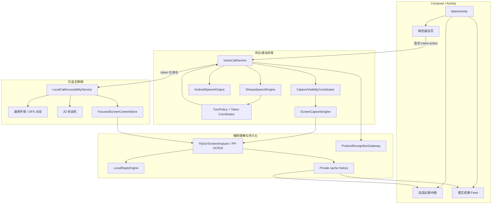
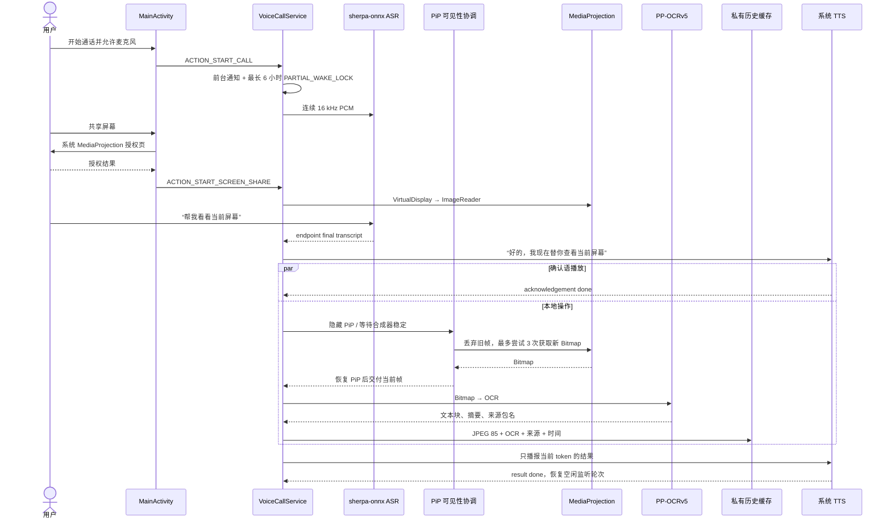
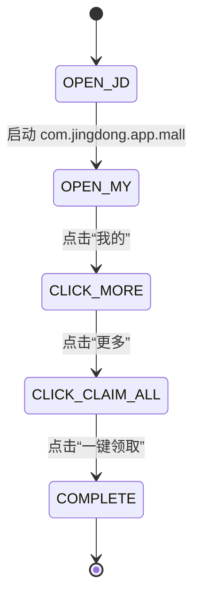
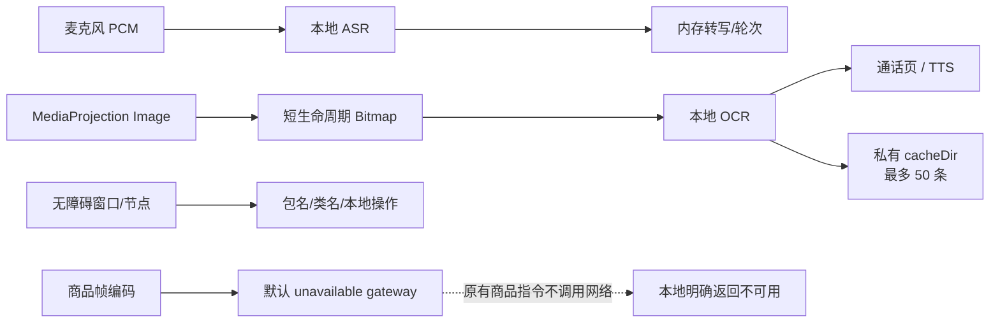

# 本地 AI 通话 Android 技术方案

## 1. 目标与实现边界

本仓库实现一个独立 Android Demo，验证“前台语音会话、系统屏幕共享、按需取帧、本地 OCR、画中画预览、图文历史、无障碍语音控制和京东演示自动化”的完整链路。它不依赖天猫宿主类、MTop SDK、fastjson、阿里内部 Maven 仓库；长截图识别使用 INTERNET 权限。

这是一套公开 Android API 上的可运行复现方案，不代表豆包客户端的内部实现。工程的默认商品识别网关明确不可用，不伪造网络结果。

构建基线保持为：namespace/application ID `me.fleey.ppocrv5`、minSdk 26、targetSdk 35、compile SDK 36.1、Java 21、NDK 28.1、C++17、单 ABI `arm64-v8a`，并保留原有 PP-OCRv5/LiteRT JNI 管线。

## 2. 总体架构

主要资源只有一个所有者：`VoiceCallService` 持有 ASR、TTS、MediaProjection、OCR worker、WakeLock 和当前轮次；`MainActivity` 持有页面、授权入口和 PiP 窗口；无障碍服务只持有待执行命令与当前窗口节点的短生命周期引用。跨组件结果通过 token、状态仓库和私有历史索引关联。

## 3. 端到端时序

若授权撤销、通话结束、轮次被 `先停一下` 中断或 token 过期，后续回调会被状态门禁丢弃，避免旧任务覆盖新会话。

## 4. 前台服务、通知和 WakeLock

`VoiceCallService` 是未导出的前台服务，Manifest 声明 `microphone|mediaProjection`。启动通话后它立即展示低重要度常驻通知；通知文本区分“后台聆听”和“通话并共享屏幕”，并提供结束动作。

服务返回 `START_NOT_STICKY`，不会在系统回收后无条件自启。`PARTIAL_WAKE_LOCK` 不引用计数，最长获取 6 小时，结束通话或服务销毁时释放。它只能降低 CPU 在活跃会话中休眠的概率，不能绕过 Android 后台限制：

- 用户强行停止应用后不能自行恢复；
- OEM 省电策略或系统内存回收仍可能结束进程；
- 通知权限影响通知可见体验，但不是“保活授权”；前台服务仍受系统政策约束；
- 锁屏和新版 Android 的投屏政策可能停止 MediaProjection；
- 常驻通知、前台服务和 WakeLock 都不等于“永久保活”。

## 5. 流式语音、轮次和播报打断

### 5.1 一句话的开始和结束

`SherpaSpeechEngine` 使用 `AudioRecord` 采集 16 kHz、单声道、PCM 16-bit，每次读取 1,600 个采样点。音频持续送入 sherpa-onnx 在线识别流：

- 文本变化时上报 partial，用于实时口令检测；
- 模型 `isEndpoint(stream)` 为真时产生 final，重置流并把它作为完整一句话交给意图层；
- 没命中任何意图时只更新文字状态，不反复播报。

### 5.2 确认语与单次结果

命中意图时先创建单调递增 query token，并立即播报确认语，例如“好的，我现在替你查看当前屏幕”。耗时操作在单线程 worker 或无障碍服务中执行。确认语结束且操作结果就绪后，协调器才播放结果；旧 token、重复回调和过期 TTS callback 都不会发布第二次结果。ASR 还单独维护“录音运行 epoch”：切换输入模式会使旧录音器的 partial/final/error 全部失效，而停止某一播报轮次或撤销投屏不会误伤仍在运行的 ASR 错误回调。

### 5.3 `先停一下` 的精确规则

ASR 在 TTS 播放期间仍然运行，以便捕获停止口令。partial 会先转为小写并去掉非字母数字字符；只有结果完全等于 `先停一下` 才中断当前确认语/结果语并使 token 失效。`请先停一下`、`先停一下然后继续` 或其他新问题都不会打断，当前播报完成后才接受下一轮。

### 5.4 公放输入开关不是内录

关闭“听到公放声音”时，策略优先使用 `VOICE_COMMUNICATION`，在设备支持时开启 AcousticEchoCanceler，并尝试开启 NoiseSuppressor。打开时改用 `VOICE_RECOGNITION`，关闭回声消除和降噪，让扬声器声音有机会经空气被麦克风拾取。

它没有使用 AudioPlaybackCapture、MediaProjection 音频或系统混音流，因此不是数字内部音频捕获；识别效果受音量、距离、房间回声和厂商音频实现影响。活动通话中切换开关会重建 `AudioRecord`，但保留通话和投屏会话；空闲时只保存偏好，不启动 Service。

## 6. MediaProjection、取帧和 OCR

### 6.1 授权生命周期

`MainActivity` 通过 `MediaProjectionManager.createScreenCaptureIntent()` 打开系统授权界面，只有 `RESULT_OK` 和系统返回数据存在、且结果仍属于发起授权的同一通话 epoch 时才交给服务；授权框期间已结束或重开的旧结果会被忽略。每个新的投屏会话需要新的授权结果，应用不能静默续期。系统撤销投屏时，`MediaProjection.Callback.onStop()` 还会携带所属通话 epoch，只有仍匹配当前通话才会释放当前共享状态、清空当前帧并显示重新授权入口；用户主动停止共享不会被误报为系统撤销，纯无障碍任务也不因投屏停止而失效。

### 6.2 当前关键帧是 Bitmap

授权后，`ScreenCaptureEngine` 以设备整屏尺寸创建 RGBA_8888、队列深度 2 的 `ImageReader`。请求到来时先丢弃队列旧帧，再轮询 `acquireLatestImage()`；按照 `rowStride` 和 `pixelStride` 复制到带 padding 的 Bitmap，必要时裁剪为真实屏幕宽高。

每次 `captureNext` 最多等待 1 秒。`ScreenCaptureRetryPolicy` 总共尝试 3 次（不是“首次 + 3 次重试”），尝试间默认等待 120 ms；没有成功帧才返回一次失败。

### 6.3 避免画中画进入关键帧

`LocalCallCaptureVisibilityCoordinator` 在 PiP 进入或宽高比更新后设置 500 ms 安全窗口。取帧时要求 Activity 临时隐藏 PiP 内容（窗口 alpha 置 0，并协调 `FLAG_SECURE`），等待两个 UI frame callback，再额外等待 120 ms 合成器稳定，然后丢弃旧帧并取新帧。隐藏、恢复和 host generation 都有超时/租约校验；恢复失败或 Activity 重建会丢弃已经捕获但不再安全的 Bitmap。

这是降低污染概率的工程策略，不是系统提供的“排除本应用 PiP 图层”API。不同 Android/OEM 合成时序下，不能承诺每张 MediaProjection 系统合成帧都绝不包含画中画。

### 6.4 OCR、所有权和回收

读屏路径把 Bitmap 交给 `PpOcrScreenAnalyzer`，由 PP-OCRv5 完成文字检测/识别，再按阅读顺序去重、过滤并保留最多 24 行，播报最多前 8 行。只有 OCR 摘要非空并且轮次、通话、投屏仍有效时，才在同一提交门禁中保存历史并更新页面。

Bitmap 所有权规则：

- `VoiceCallService` 拥有取帧返回的原始 Bitmap，OCR/保存结束后在 `finally` 回收；
- PiP host 失效、恢复超时或线程中断时，可见性协调器通过 discard callback 恰好回收被拒绝的结果；
- 商品编码器只回收自己创建的缩放临时 Bitmap，调用方仍负责原始帧；
- `Image`、无障碍 root/child/candidate 节点均在完成后释放或 recycle。

## 7. 当前页面、来源应用与历史 Feed

无障碍服务监听 `TYPE_WINDOW_STATE_CHANGED` 和 `TYPE_WINDOW_CONTENT_CHANGED`。窗口状态变化时记录事件的 `packageName` 和 `className`；同包内容变化沿用最近类名。OCR 保存时读取这个快照，把来源包名写进历史项。

这里得到的是“最近一个无障碍窗口事件暴露的包名/类名推断”，不是 Android ActivityManager 的完整或可靠 Activity 栈：

- 未开启无障碍时来源可能为空；
- WebView、Compose、浮层或厂商框架可能只暴露通用类名；
- 事件顺序与截图合成时刻可能存在偏差；
- 不能据此保证业务页面身份。

历史目录为 `cacheDir/local_call_history`，结构是 JPEG 文件和原子替换的 `index.json`。全帧 JPEG 先在通话 session 锁和仓库 monitor 之外压缩成不可见的 provisional 文件，再在 session 锁内用一个短复验点决定是否接受：取消先发生就只删除 provisional 文件，不写索引也不触发淘汰；复验先成功则在锁外原子提交索引，之后仅在轮次仍可见时更新当前页面。Activity 通过 IO 协程加载索引、检查图片并读取图片边界，不在主线程做这些磁盘工作：

- JPEG 质量 85；
- schema version 1；
- 默认最多 50 条，超出后删除最旧条目的图片；
- 结果页按捕获时间最新在前，展示图片、时间、来源包名和 OCR；
- 图片解码按目标显示尺寸采样，内存 LRU 预算为 16 MiB；
- 这是可被系统清理的应用私有缓存，不是相册或长期数据库。

用户离开应用时记录时间边界，并通过 IO 快照补齐该边界之前的全部历史 ID；回到应用后的异步判定绑定 Activity resume epoch，离开或暂停会使旧回调失效。只有发现边界之后产生的新截图才自动打开结果页，通话页也提供手动入口。

## 8. 自适应画中画

PiP 进入条件同时满足：通话进行中、屏幕共享进行中、用户开关开启，并且发生 `onUserLeaveHint`。返回应用后系统退出 PiP，页面按正常通话/结果路由渲染。

两种显示模式：

| 模式 | 触发条件 | 内容与比例 |
|---|---|---|
| `TEXT_ONLY` | 当前通话还没有有效截图 | 仅显示“等待你询问当前页面”，请求 1:1 紧凑比例。 |
| `FRAME_WITH_TEXT` | 当前通话已有可读缓存图片 | 只显示关键帧和 OCR；比例来自图片宽高，并限制在 Android 允许的 100:239 到 239:100。 |

首张有效截图写入后，Activity 在 PiP 中更新参数以切换比例。PiP 不展示按钮、标题或其他通话控制。通话结束或投屏停止/撤销后，PiP 先切换为不含缓存截图的中性提示并结束 Activity，避免遗留旧画面。系统最终浮窗尺寸和动画仍由设备决定；lint 会提示 Android 12 的 auto-enter/source-rect 建议，但当前实现坚持“用户离开时按三项条件手动进入”，没有把这个建议当成功能保证。

## 9. 通用无障碍语音控制

无障碍配置可读取窗口内容、执行手势、报告 View ID，并且不设置 `packageNames`，因此在用户授权后可面向当前前台 App。服务由系统绑定，所以组件 `exported=true`，同时强制受签名权限 `android.permission.BIND_ACCESSIBILITY_SERVICE` 保护。

| 口令类型 | 示例 | 解析/执行 |
|---|---|---|
| 上滑 | `向上滑`、`下一页` | 从屏幕 78% 高度滑到 22%。 |
| 下滑 | `向下滑`、`上一页` | 从 22% 滑到 78%。 |
| 左滑 | `向左滑` | 从 82% 宽度滑到 18%。 |
| 右滑 | `向右滑` | 从 18% 滑到 82%。 |
| 第 N 项 | `第一个`、`第3个列表项` | N 从 1 开始；优先 collection item 元数据，否则只接受 Collection/ListView/RecyclerView 容器。 |
| 文本点击 | `点下关注按钮`、`点击更多` | DFS 匹配 text/contentDescription 的完全或包含关系；先可靠 View ID，再节点或最近可点击祖先。 |

手势时长为 360 ms。命令采用进程级单调 token、可撤销的 pending/claimed 租约、过期检查和 exactly-once result bus；每次 `performAction`/`dispatchGesture` 都与取消操作在同一 token 门禁中线性化。通用手势另有 2 秒回调 watchdog，超时会释放 claimed 租约，迟到回调不再影响后续命令。无障碍未开启、服务停止、手势取消、超时或节点不存在都会明确返回失败。通用指令绝不做像素坐标兜底，以降低误触风险。

## 10. 京东演示自动化

语音 `去京东打卡` 进入专用状态机：

每步都要求当前 root 属于 `com.jingdong.app.mall`，并深度优先查找精确规范化标签。点击顺序是可靠 View ID 对应节点、目标节点、最近可点击祖先；成功 Toast 会如实区分 `VIEW_ID`、`ACCESSIBILITY_NODE` 或 `FALLBACK_COORDINATE`，不会把“无可用 ID 的节点点击”描述成 ID 点击。

| 目标 | 节点搜索预算 | 坐标兜底 |
|---|---:|---|
| `我的` | 8 秒 | 无 |
| `更多` | 5 秒 | 物理像素 `[916,475]` |
| `一键领取` | 5 秒 | 物理像素 `[500,574]` |

两个兜底手势只在对应节点搜索超时后使用，并且只有 `GestureResultCallback.onCompleted` 才算成功。回调预算 2 秒、页面转换等待 500 ms；整体 deadline 由各阶段预算、两个回调预算、两个页面转换和 1 秒调度余量统一计算。

固定物理像素不会随分辨率、密度、导航栏、横竖屏或京东改版自动适配，因此只是当前 Demo 的临时多模态兜底占位，风险高于节点点击。必须在指定机型、显示缩放和京东版本验证，正式方案应换成经用户确认的视觉定位或删除兜底。

## 11. 商品识别独立契约

语音 `帮我看一下这个商品` 要求屏幕共享有效，并复用 PiP 隐藏、三次取帧和 token 取消门禁。`ProductImageEncoder`：

- 保持宽高比，最长边最多 640 px，不放大小图；
- 从 JPEG quality 100 向下选择，结果最多 80 KiB；
- Base64 使用 `NO_WRAP`；
- 请求中的 `imgSize` 使用实际编码后宽高。

保留的请求模型为：

- API：`mtop.tmall.kangaroo.core.service.route.aldlampservicefixedresv2`；
- version：`1.0`；response type：`originaljson`；
- 顶层 data 只有 `params`，值是业务 JSON 字符串；
- `bizId=666`、`resId=32076707`、`pageSize=10`、`from=homeScan`、`pageNumber=1`、`domainType=0`、`regionIndex=1`、`isHongmeng=0`；
- `picBase64`、`imgSize`、`requestTime` 来自当前帧和当前时间，item/sku 字段保持空串。

响应解析支持完整 root 或 data root，只读取 `resultValue[32076707].data[0].productList[0]`。标题优先 `titleNew`、回退 `shortTitle`，结果只格式化第一个商品的名称和价格。

这些只是可注入适配器的编码/解析契约。独立版 `UnavailableProductRecognitionGateway` 不执行 I/O，固定返回“独立版未配置商品识别服务”；长截图识别另行通过 HTTPS 请求，Manifest 已申请 INTERNET 权限，工程不包含 MTop/fastjson/阿里宿主依赖。商品路径也不会把帧写入 OCR 历史。

## 12. 权限、授权与私有数据流

| 权限/能力 | 类型 | 触发时机 | 数据与边界 |
|---|---|---|---|
| `RECORD_AUDIO` | 运行时危险权限 | 用户点击开始通话 | 麦克风 PCM → 本地 sherpa-onnx；不保存录音。 |
| `POST_NOTIFICATIONS` | Android 13+ 运行时权限 | 首次页面启动且通知未允许 | 展示前台服务通知；不是保活权限。 |
| `FOREGROUND_SERVICE` | 普通权限 | 启动通话服务 | 用户可感知的后台会话。 |
| `FOREGROUND_SERVICE_MICROPHONE` | FGS 类型权限 | 通话录音 | 只允许声明类型内使用，仍需麦克风授权。 |
| `FOREGROUND_SERVICE_MEDIA_PROJECTION` | FGS 类型权限 | 投屏期间 | 仍需每次 MediaProjection 系统授权。 |
| `WAKE_LOCK` | 普通权限 | 通话开始 | PARTIAL、非引用计数、最长 6 小时。 |
| MediaProjection consent | 系统授权页 | 用户点击共享屏幕 | 允许系统合成帧进入本应用；可随时撤销。 |
| Accessibility service | 系统设置手动开启 | 用户点击无障碍设置入口 | 可观察包名/类名、读取并操作可访问节点；高敏感、可随时关闭。 |
| JD package visibility | `<queries>` | 检查/启动京东 | 只声明 `com.jingdong.app.mall`，不是数据权限。 |

默认数据流全部留在本机：

应用不保存录音。长截图会保存到相册，合图成功后上传图片至预发商品识别接口；该流程不上传转写、OCR 文本或节点内容。系统 TTS 是设备服务，其可用语音与实现由 ROM/已安装语音包决定。

## 13. Manifest 和组件安全边界

- `MainActivity`：launcher、`exported=true`、NoActionBar 主题、支持 PiP，并处理 orientation/screenSize/smallestScreenSize/screenLayout 配置变化。
- `VoiceCallService`：`exported=false`，前台类型 `microphone|mediaProjection`。
- `LocalCallAccessibilityService`：系统必须能绑定，因此 `exported=true`；同时受 `BIND_ACCESSIBILITY_SERVICE` 保护，并通过 XML 元数据声明能力。
- `<queries>` 只有京东包可见性项。
- 源 Manifest 声明 `INTERNET` 供长截图图片识别使用；没有 `ACCESS_NETWORK_STATE` 或天猫/淘宝/阿里宿主组件。

## 14. 失败、取消和并发策略

- 通话、读屏、商品、无障碍和 JD 操作都携带单调 token；结束、停止投屏、停止播报或服务重建后，旧 token 结果被丢弃。
- 屏幕/OCR 在单 worker 串行执行；销毁时先拒绝新任务，再把 OCR close 排在已接受任务之后，避免主线程等待。
- 截图历史提交同时检查当前轮次、通话和投屏状态，避免撤销后仍落盘。
- 无障碍手势只能在系统 callback 确认完成后返回成功，late callback 不能完成新轮次。
- TTS 未就绪或入队失败时显示错误并完成该语音阶段，避免轮次永久卡住。
- 任意节点遍历、Bitmap、ImageReader、VirtualDisplay、MediaProjection、AudioRecord、AEC/NS、TTS 和 WakeLock 都有显式释放路径。

## 15. 真机验证清单（尚未由 JVM/打包验证替代）

以下项目必须在不含私人数据的测试机上人工执行。建议至少覆盖 Android 9、13、15（或产品要求的等效最低/主流/最新版本），并记录机型、ROM、显示缩放、JD 版本和 TTS 引擎。

- [ ] Android 9：首次麦克风授权、开始/结束通话、切到后台后 ASR 与常驻通知。
- [ ] Android 13：通知允许/拒绝两条路径，前台服务启动与通知栏结束动作。
- [ ] Android 15：MediaProjection 单次授权、用户停止共享、锁屏/解锁后的撤销行为。
- [ ] 连续 ASR endpoint：短句、停顿、噪声、远场、中英混说。
- [ ] TTS 播报时说普通问题不会打断；只说 `先停一下` 会立刻停止且不产生旧结果。
- [ ] 公放输入开关切换后通话和投屏不结束；验证仅为麦克风声学拾取而非数字内录。
- [ ] 取帧失败能进行最多三次尝试，并且最终只播报一次失败。
- [ ] PiP 初始为紧凑文字模式；首张有效截图后切为图文比例；返回应用退出 PiP。
- [ ] 多次 PiP 进入/更新后检查截图污染概率；若仍含 PiP，记录 ROM/时序，不宣称系统保证排除。
- [ ] 外部 App 产生成功 OCR 后回到本应用自动进入图文 Feed；手动结果入口、50 条淘汰和缓存清理正常。
- [ ] 无障碍关闭/开启状态刷新，跨 App 包名/类名推断符合事件而非“Activity 栈”表述。
- [ ] 上下左右滑、下一页/上一页、第 1/N 个列表项和文本按钮点击；节点不存在时无坐标误触。
- [ ] 京东当前版本完整执行 `我的 → 更多 → 一键领取`，逐步核对 Toast 的 ID/节点/坐标来源。
- [ ] 在目标分辨率验证 `[916,475]` 和 `[500,574]`；非目标分辨率确认失败是可控的，不误点敏感操作。
- [ ] 商品口令完成取帧后只返回“独立版未配置商品识别服务”，且没有网络流量和商品历史落盘。
- [ ] 用户强停、系统回收、授权撤销、辅助功能被系统中断后资源均释放，应用不声称自动恢复。

JVM 单元测试、lint 和 Debug 打包只能覆盖策略、解析、状态机、资源声明和编译；不能证明上述系统 UI、合成器、音频路由、第三方节点树或固定坐标在真机上正确。

## 16. 第三方组件

- [PPOCRv5-Android](https://github.com/iFleey/PPOCRv5-Android) / [PaddleOCR](https://github.com/PaddlePaddle/PaddleOCR)：PP-OCRv5 模型及 Android/LiteRT 基础。
- [sherpa-onnx](https://github.com/k2-fsa/sherpa-onnx)：端侧流式中文 ASR。
- [LiteRT](https://ai.google.dev/edge/litert)：端侧推理运行时。
- [Abseil](https://abseil.io/)：vendored C++ 基础库。

固定版本、提交、模型校验和许可证信息见仓库根目录 [NOTICE.md](../NOTICE.md) 与 [LICENSE](../LICENSE)。
